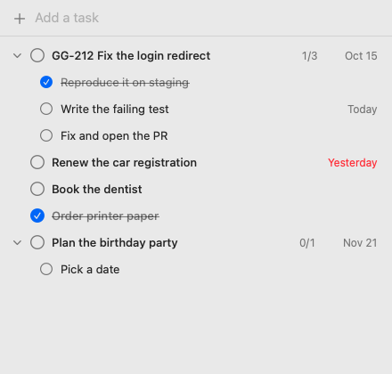

# Checkoff

A small, native Mac to-do list. Add tasks, check them off, group a few under a
parent, and give any of them a due date if you want one. That is all it does.



## Why

Microsoft To Do without the Microsoft account. The open source alternatives
are either web apps in a wrapper or do far more than a checklist needs, and
none of the small native ones can put three steps under one ticket.

## What it does

- **Tasks:** type in the field at the top and press Return. Click the circle to
  check a task off. Double-click a title to rename it.
- **Sub-tasks:** one level deep. Drag a task onto the middle of another to put
  it under that one, or hover a task and press `+` to type sub-tasks one after
  another. A parent shows how many are done, like `1/3`, and folds away with
  the arrow.
- **Moving:** drag a task onto the top or bottom edge of another to reorder.
  Drag a sub-task out to make it a task of its own. The right-click menu has
  **Move Under** and **Move to Top Level** if you would rather not drag.
- **Due dates:** optional. Hover a task and click the calendar at the right
  edge, or type `@due(2026-10-15)` in the title. The date sits at the right of
  the row and turns red once it has passed. A task with no date shows nothing.
- **Done tasks** stay where they are, struck through. The eye button in the
  toolbar hides them.

Checking a parent does not check its sub-tasks. If some are still open, the
app asks first.

Not in this version: sync, reminders, notifications, multiple lists.

## The task file

Tasks live in one Markdown file, `~/Checkoff/tasks.md`:

```markdown
- [ ] GG-212 Fix the login redirect @due(2026-10-15)
  - [x] Reproduce it on staging
  - [ ] Write the failing test
  - [ ] Fix and open the PR
- [ ] Book the dentist
```

The app re-reads the file whenever it changes, so you can edit it in any
editor, from a script, or have a coding agent add and tick tasks, and the
window updates within a second. Every change you make in the app is applied
to the file as it is at that moment, so an outside edit is not overwritten.

Lines that are not tasks (headings, notes, blank lines) are kept where they
are. The app does not show them.

**File > Show Tasks File in Finder** finds the file. To keep it somewhere
else, such as a synced folder:

```sh
defaults write com.boxofraccoons.checkoff tasksFile "~/Notes/tasks.md"
```

## Requirements

macOS 14 (Sonoma) or later.

## Building

Pure SwiftPM, no Xcode project.

```sh
swift test                      # run the tests
swift run Checkoff              # run from source
Scripts/package_app.sh 0.1.0    # build dist/Checkoff.app
```

`swift run Checkoff --snapshot out.png [--dark]` draws the window with sample
tasks to a PNG. It uses a temporary file, never your own tasks.

Pushing a `v*` tag runs the release workflow, which signs and notarizes the
app and attaches a dmg to a GitHub release.

## License

MIT. See [LICENSE](LICENSE).
